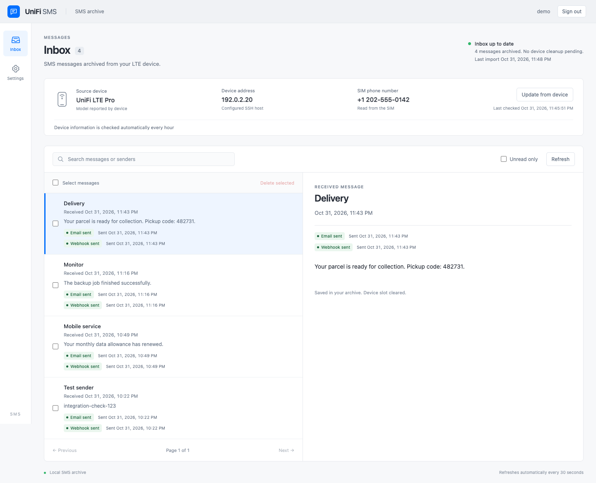

# UniFi SMS

**Read your LTE Pro's SMS in your browser or email inbox.**

Get carrier notifications and other messages sent to the SIM in your LTE Pro. UniFi SMS runs on a NAS or any other host with Docker, keeps a searchable message archive, and forwards new SMS to email or webhooks. Use REST API or MCP to search and manage the archive from other tools.

## Install on a NAS or another Docker host

| Your system | Start here | Open after installation |
| --- | --- | --- |
| **Synology** with Container Manager | [Paste one installation script into DSM Task Scheduler](docs/install-synology.md) | `http://NAS_IP:8098` |
| **UGREEN** with the Docker app | [Paste the Compose configuration into a Docker project](docs/install-ugreen.md) | `http://NAS_IP:8098` |
| **Other Docker hosts** | [Start with Docker Compose](docs/install-docker.md) | `http://localhost:8098` on the host |

The guides use host port **8098**. If it is already in use, follow the port-change steps for [Synology](docs/install-synology.md#if-the-port-is-already-in-use), [UGREEN](docs/install-ugreen.md#if-the-port-is-already-in-use), or [Docker Compose](docs/install-docker.md#choose-another-host-port). Use your chosen port in the browser URL; keep container port **8000**.

Both NAS guides finish in your browser: **install → create an administrator → connect the LTE Pro → receive a test SMS**. No NAS SSH, source checkout, external database, registry account, or `.env` file is needed for NAS installation.

You need a NAS or another Docker host that supports **Linux AMD64 or ARM64 containers**, the LTE Pro's IP address, and its **device SSH credentials** or access to UniFi Network to add a key. The host must be able to reach the device over SSH. Use one importer per LTE Pro. For NAS-specific model and software requirements, see the corresponding guide; 32-bit ARM is not supported.

## What you get

- **See messages sent to your SIM.** Read notifications from your mobile carrier and SMS from other senders in one searchable inbox.
- **Receive SMS in your email inbox.** Forward new messages through your SMTP server, with a test-email button, automatic retries, and delivery status for each SMS.
- **Use SMS from scripts through REST API.** Search, read, create, update, and delete archive records with a dedicated access key.
- **Connect an MCP client.** Give a compatible client access to the archive through Streamable HTTP and a separate Bearer key.
- **Trigger workflows with webhooks.** Send a JSON event for each new SMS to your application or automation service, with an optional secret header, retries, and visible delivery status.
- **Keep device storage available.** The LTE Pro has limited space for SMS. UniFi SMS saves each segment to the archive before deleting its device copy to make room for new messages.

One container runs the web app and importer; one persistent volume holds the archive and settings. The importer checks for messages about once a minute. Messages it cannot safely decode, save, or verify remain on the device with a warning. See [SMS import and deletion](docs/behavior.md#sms-import-and-deletion) for details.

*Example inbox using synthetic device details, messages, and statuses.*

## Verify your first SMS

After you approve the LTE Pro in the connection wizard, imports begin and archived copies are removed from the device to free its slots. Send a test SMS to the SIM, wait for the next scan, and open it in the inbox. **Saved in your archive. Device slot cleared.** confirms both steps for that message.

Need help with SSH credentials or the device fingerprint? Follow [First launch](docs/nas-first-run.md). Entering the LTE Pro's IP directly is the shortest route; local network search is optional.

## Forward new SMS to email

1. Open **Settings → Email forwarding** and enter your SMTP server, sender, and recipients.
2. Select **Send test email** and check the recipient inbox. The test uses the form values without saving them.
3. Select **Enable email forwarding**, then **Save settings**.
4. Send a **new SMS** to the SIM. Check that it arrives by email and shows **Email sent** in UniFi SMS.

Existing complete messages are not forwarded retroactively. Failed deliveries retry automatically without blocking archiving. **Email sent** means the SMTP server accepted the message; check the destination inbox for delivery. See [email setup](docs/nas-first-run.md#step-7-set-up-optional-forwarding-and-integrations) and [delivery behavior](docs/behavior.md#email-delivery).

## Connect scripts, MCP clients, and webhooks

All integrations are optional, disabled by default, and configured in the browser.

| Connect with | Use it for | Setup and first check |
| --- | --- | --- |
| **REST API** | Search and manage archive records over HTTP | [Enable a key and find your test SMS](docs/integrations.md#use-the-rest-api) |
| **MCP** | Let a compatible client search and manage the archive | [Connect with the official Python SDK](docs/integrations.md#connect-an-mcp-client) |
| **Webhooks** | Forward new SMS as JSON events to your workflows | [Configure a receiver and verify delivery](docs/integrations.md#forward-new-sms-to-a-webhook) |

REST and MCP keys each grant read and write access to the whole archive; there is no read-only key. MCP clients need Streamable HTTP and a custom Bearer header. Creating records through either interface **does not send cellular SMS** or trigger forwarding. Webhooks are outgoing HTTP notifications. Use HTTPS for API or MCP access over a network.

## Keep your archive

**Back up the complete data volume:** imported SMS are removed from the LTE Pro. The volume includes messages, accounts, settings, and encryption keys, so protect backups as secrets. Replacing the container preserves the archive when you keep its volume. Deleting the volume deletes the archive.

Follow [backup, restore, and upgrade instructions](docs/nas-maintenance.md), including a Synology backup task that requires no NAS SSH. `latest` tracks the latest stable release; installed containers update when you redeploy them.

## Documentation and support

- [First launch: administrator, device credentials, and test SMS](docs/nas-first-run.md)
- [Backups, upgrades, migration, HTTPS, and password recovery](docs/nas-maintenance.md)
- [Import, device cleanup, and delivery behavior](docs/behavior.md)
- [REST API, MCP, and webhook reference](docs/integrations.md)
- [Docker host access and troubleshooting](docs/install-docker.md#troubleshooting)
- [Source builds and development](docs/development.md)
- [Release validation](docs/releases.md) and [release notes](https://github.com/akinfold/unifi-sms/releases)
- [Report a bug or suggest a feature](https://github.com/akinfold/unifi-sms/issues)

Contributions are welcome — see [Contributing](CONTRIBUTING.md). Report vulnerabilities privately using the [Security policy](SECURITY.md).

Released under the [MIT License](LICENSE). UniFi SMS is an independent project, not affiliated with or endorsed by Ubiquiti.
